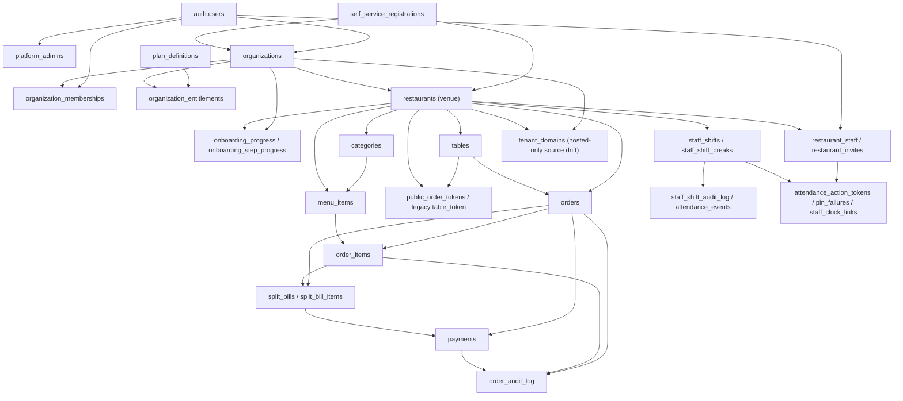

# Aveniq Supabase database architecture and migration audit

Date: 12 August 2026  
Scope: all repository migrations, current application database usage, and the connected Aveniq Supabase project  
Safety mode: read-only database inspection; no DDL, DML, migration repair, deployment, or destructive action

## Executive verdict

The database cannot currently be reconstructed or described safely from migration filenames alone.

The repository contains 43 SQL migration files, but two use version `022`, migration `011` has been edited after being tracked, 28 migration files are untracked, and the hosted migration ledger contains only 14 later timestamped entries. The hosted schema nevertheless contains most of the unrecorded repository objects plus additional live-only objects (`tenant_domains`, hostname tenancy RPCs, kitchen-print columns/functions, and extra staff roles). This is conclusive migration-history drift. Do not run `supabase db push`, `migration repair`, or a linked reset until the history and object fingerprints are reconciled.

The most urgent functional/security defects are:

1. A legacy authenticated payment RPC can mark an order paid without an amount or payment-ledger row.
2. A legacy authenticated tenant-creation RPC can create unmetered, organisation-null restaurants.
3. Revocable hashed QR tokens are bypassed by the older anonymous ordering API.
4. The newer token ordering RPC can create under-totalled orders and ignores GST/options/idempotency.
5. The application is receiving live `403 permission denied for table payments` errors every polling cycle.
6. Fulfilment, payment, void, and reporting states conflict. The live data currently contains eight non-test completed orders, totalling $318, with no completed ledger payment.
7. Migration `038` malformed 41 live `SECURITY DEFINER` search paths by turning comma-separated schema lists into one quoted, nonexistent schema name. The QR functions still make unqualified `pgcrypto` calls and are therefore at direct runtime risk.

No historical migration should be edited to address any of these. Every remediation below is designed as a new, uniquely timestamped, forward-only migration after a clean staging replay and usage audit.

### Severity summary

| Severity | Confirmed themes |
| --- | --- |
| CRITICAL | migration provenance; ledger-bypassing payment RPC; unmetered tenant creation; legacy QR authorisation bypass; corrupt token-order constructor |
| HIGH | live payment ACL failure; fulfilment/payment dead ends; void/ledger inconsistency; malformed definer search paths; local-only attendance; PIN brute-force boundaries; trial/sample conflict; missing tenant-composite integrity; ownership divergence; non-persisted splits; production seed collision; live-only broken kitchen printer; attendance retention; heavy polling/report scans |
| MEDIUM | dormant broad policies; sensitive-column projection; role/source drift; presence regression; duplicate order numbers; split allocation constraints; timezone provenance; stale compatibility surfaces; missing query-specific indexes |
| LOW | timestamp-semantic inconsistency; stale verification comments; exposed extension/advisor hygiene; unused one-time helper |

## Evidence model and confidence

This audit deliberately separates three sources of truth:

- **Repository-intended state:** every SQL file in `supabase/migrations`, read in filename order, including both `022` files and the timestamped timezone migration.
- **Hosted state:** read-only `pg_catalog`, information-schema, RLS/ACL, function, trigger, constraint, index/statistics, aggregate-integrity, advisor, API-log, and migration-ledger queries against the active Aveniq Supabase project.
- **Application-assumed state:** `app.js`, `supabase-client.js`, HTML, configuration, scripts, tests, and architecture/verification documentation.

The hosted inspection did not select customer names, emails, tokens, PIN hashes, notes, or row identifiers. Integrity checks returned aggregate counts only. No live function with write effects was invoked.

Confidence labels used below:

- **Confirmed live:** observed in the hosted catalog, grants, aggregate data, or logs.
- **Confirmed source:** deterministic from the current SQL/application source.
- **Requires replay:** PL/pgSQL/dependency or migration-order behaviour that needs an isolated clean database.
- **Requires product decision:** the database cannot infer the intended business rule safely.

## 1. Database architecture map



### Core object catalogue

| Domain | Primary objects | Relationship and architectural observation |
| --- | --- | --- |
| Identity | `auth.users`, `platform_admins` | Auth owns identity. Platform administration is a separate one-row-per-user marker. There is no application profile table. |
| Organisation/tenant | `organizations`, `organization_memberships` | Organisation is the commercial tenant. Membership currently models owner only. `organizations.owner_user_id` duplicates that authority. |
| Venue/restaurant | `restaurants` | A restaurant row is the venue. `organization_id` is nullable for legacy venues. Venue state is fragmented across `status`, `venue_status`, `is_active`, `is_open`, `ordering_enabled`, and `attendance_enabled`. |
| Staff and roles | `restaurant_staff`, `restaurant_invites` | Venue membership and role. Repository constraints end at owner/manager/staff/kitchen/cashier; hosted schema additionally has waitstaff/attendance without a source migration. Ownership is also duplicated in `restaurants.owner_user_id`. |
| Menu | `categories`, `menu_items` | Menu items carry both `category_id` and category text plus multiple image/option compatibility fields. The FK to category does not bind category and item to the same venue. |
| Physical tables | `tables` | Contains parallel identifiers/names (`table_number`, `table_name`, `name`, `local_id`) and legacy raw QR material (`table_token`, `qr_code_url`). |
| QR/public access | `public_order_tokens`, `tables.table_token`, `orders.public_token` | New tokens are stored hash-only and revocable. Legacy raw-token/local-ID RPCs remain. `orders.public_token` has no current source consumer. |
| Ordering | `orders`, `order_items` | Order totals and state are stored on the order; item snapshots have several parallel name/price columns. Fulfilment and financial terminality are overloaded into `orders.status`. |
| Payments/splits | `payments`, `split_bills`, `split_bill_items` | Ledger exists, but orders also duplicate payment status/method/time. Split structures are not populated by the application UI. |
| Attendance | `staff_shifts`, `staff_shift_breaks`, `attendance_action_tokens`, `attendance_pin_failures`, `attendance_events`, `staff_clock_links` | Shared/public PIN flows write database shifts. The primary authenticated attendance page instead writes only browser local storage. |
| Trial/entitlements | `plan_definitions`, `organization_entitlements` | One entitlement per organisation; no subscription, invoice, customer, webhook, or billing-event tables. Organisation-null venues bypass limits by design. |
| Onboarding | `self_service_registrations`, `onboarding_progress`, `onboarding_step_progress` | Auth triggers snapshot signup metadata and provision after verification. The Before User Created hook is documented but absent from local `config.toml`; hosted dashboard configuration was not observable. |
| Audit | `order_audit_log`, `payments` void metadata, `staff_shift_audit_log`, `attendance_events` | No general audit for entitlement, ownership, role, organisation, or onboarding changes. Shift correction audit is not trigger-enforced. |
| Reporting | `reporting.*` views plus public report RPCs | Security-invoker views use operational `completed` state as revenue truth and item facts do not exclude voided items. |
| Hosted-only drift | `tenant_domains`, `get_public_tenant_context`, kitchen print columns/functions | Present live and used/possibly used, but no repository migration can reconstruct them. |

### Tenant and ownership model

The intended hierarchy is `organization -> restaurants (venues) -> venue-scoped operational data`. It is not enforced consistently:

- Legacy `restaurants.organization_id IS NULL` rows are explicitly exempt from entitlements.
- Organisation ownership, organisation membership, venue `owner_user_id`, and venue `restaurant_staff(role='owner')` are independent mutable authorities.
- The hosted aggregate check found one restaurant with three owner memberships.
- `accept_restaurant_invite` can rewrite `restaurants.owner_user_id` without reconciling organisation ownership or removing the previous owner.
- Denormalised `restaurant_id` columns are useful for RLS and query speed, but independent single-column FKs do not prove all referenced rows belong to that restaurant.

## 2. Migration timeline and history

Legend: **T** tracked and unchanged, **M** tracked but modified, **U** untracked working-tree file. These are worktree facts, not proof of hosted application.

| Version/file | Git | Purpose and effective-history note |
| --- | --- | --- |
| `001_initial_schema.sql` | T | Core restaurants, staff, categories, tables, menu, orders/items, initial RLS/helpers/public and owner RPCs, Realtime orders publication. |
| `002_platform_admin.sql` | T | Platform administrators and platform venue creation. |
| `003_restaurant_staff_invites.sql` | T | Invites, acceptance, team list, role management. |
| `004_role_hardening.sql` | T | Order-status RPC and removal of direct order update grants. |
| `005_all_round_staff.sql` | T | Adds `staff` role; replaces invite and status functions. |
| `006_function_permission_hardening.sql` | T | Explicit function revokes/grants. |
| `007_explicit_data_api_grants.sql` | T | Explicit table/view grants and revocation of future default Data API privileges for role `postgres`. |
| `008_authoritative_option_pricing.sql` | T | Menu option validation; replaces public menu/order constructor with server-side pricing. |
| `009_reporting_layer.sql` | T | Reporting schema, facts/views/RPCs, report indexes. |
| `010_advisor_index_rls_tuning.sql` | T | FK indexes and RLS init-plan tuning. |
| `011_consolidate_rls_policies.sql` | **M** | Consolidates policies; working copy adds policy drops and no longer matches its immutable tracked hash. |
| `012_self_service_signup_validation.sql` | U | Auth Before User Created validation function; dashboard/hook setup is external. |
| `013_verified_self_service_provisioning.sql` | U | Organisations, memberships, private signup snapshot, onboarding base, Auth triggers, provisioning. |
| `014_payment_records.sql` | T | Payment fields on orders and related indexes. |
| `015_organization_restaurant_integrity.sql` | U | Requires organisation for rows considered managed venues. |
| `016_seed_sake_street_test_tenant.sql` | T | Creates/reuses active Sake Street slug and predictable table tokens; data-bearing fixture. |
| `017_seed_sake_street_categories.sql` | T | Repairs/seeds categories for that fixture. |
| `018_record_restaurant_order_payment.sql` | T | Legacy order-only payment RPC; still live and dangerous. |
| `019_trial_entitlement_foundation.sql` | U | Plans, entitlements, 14-day trial basis, resource/order enforcement, entitlement RPC. |
| `020_self_service_onboarding_workflow.sql` | U | Per-step onboarding and business/contact details. |
| `021_sample_qr_test_order_activation.sql` | U | Sample data, test orders, hashed QR tokens, public token ordering, venue activation. Defines `activate_current_venue` twice. |
| `022_exclude_test_orders_from_reporting.sql` | U | Replaces report facts to exclude test orders. **Version collision.** |
| `022_staff_presence.sql` | U | Heartbeat column/index/RPC and team presence projection. **Same version collision.** |
| `023_fix_staff_invite_entitlement_trigger.sql` | U | Replaces entitlement trigger body for multi-table use. |
| `024_harden_entitlement_trigger_permissions.sql` | U | Revokes direct trigger-function execution. |
| `025_menu_image_uploads.sql` | U | Public storage bucket and owner/manager upload policy. |
| `026_frontdesk_split_bills.sql` | U | Split tables, payment ledger, recorder/voider, payment read policy. |
| `027_staff_attendance.sql` | U | Shifts, breaks, shift audit and RLS. |
| `028_shared_pin_attendance.sql` | U | PIN hashes, action tokens, events, shared attendance RPCs. |
| `029_harden_shared_pin_attendance.sql` | U | Token expiry/locking and PIN/action hardening. |
| `030_shared_pin_rate_limit.sql` | U | PIN failure state and rate limiting; replaces identify/action. |
| `031_qualify_pgcrypto_attendance.sql` | U | Qualifies crypto functions; replaces PIN functions. |
| `032_fix_pin_rate_limit_window_column.sql` | U | Replaces identify function again. |
| `033_staff_attendance_pin_management.sql` | U | Owner boundary for PIN management and team projection replacement. |
| `034_attendance_weekly_reports.sql` | U | Attendance reporting/access and team projection replacement. |
| `035_order_integrity_audit.sql` | U | Order audit, void flows, manager approval, status replacement. |
| `036` | — | No file. A gap is legal; this is not itself a defect. |
| `037_owner_boundary_and_payment_integrity.sql` | U | Owner-only management, invites/team/PIN/payment replacements. Drops presence fields from final team projection. |
| `038_security_hardening.sql` | U | Revokes selected trigger functions and rewrites definer paths; live rewrite is malformed. |
| `039_payment_confirmation_metadata.sql` | U | Drops seven-argument payment signature and creates current ten-argument recorder. |
| `040_external_staff_clock_links.sql` | U | Revocable public staff-clock link and public PIN/action flow. |
| `041_self_service_trial_recovery_and_limits.sql` | U | Trial becomes 90-day default/10 items; provisioning recovery; insert/update limit triggers. |
| `042_harden_atomic_kitchen_voids.sql` | U | Replaces order/item void RPCs and adds atomic batch item void. |
| `20260805133843_validate_onboarding_timezone.sql` | U | Restaurant timezone validation trigger. |

### Hosted migration ledger

The connected project records only these 14 versions:

```text
20260716114639 payment_records
20260716114803 seed_sake_street_test_tenant
20260716114827 seed_sake_street_categories
20260716115053 record_restaurant_order_payment
20260716122305 set_sake_street_brand_assets
20260716124833 seed_full_sake_street_menu
20260716125013 complete_sake_street_menu_categories
20260721122201 fix_staff_invite_entitlement_trigger
20260721122354 harden_entitlement_trigger_permissions
20260721124450 menu_image_uploads
20260725065342 qualify_pgcrypto_attendance
20260725065353 fix_pin_rate_limit_window_column
20260805132642 self_service_trial_recovery_and_limits
20260805134105 validate_onboarding_timezone
```

Most foundational/live objects have no ledger entry. Several recorded versions have different hashes from the local counterparts. Only `041` and the timezone migration matched in the prior reconciliation evidence. This points to manual SQL execution, missing/rewritten ledger records, or both.

### Function supersession map

| Capability | Definition chain; last source definition wins |
| --- | --- |
| Legacy public menu/order | 001 -> 008 |
| Order status transition | 004 -> 005 -> 035 |
| Create staff invite | 003 -> 005 -> 037 |
| Team projection | 003 -> presence-022 -> 033 -> 034 -> 037 |
| Set attendance PIN | 028 -> 029 -> 031 -> 033 -> 037 |
| Identify attendance PIN | 028 -> 030 -> 031 -> 032 |
| Shared attendance action | 028 -> 029 -> 030 |
| Entitlement trigger | 019 -> 023 -> 041 |
| Provision user | 013 -> 041 |
| Activate venue | two definitions inside 021; the second replaces the first |
| Record payment | 026 -> 037; old seven-argument signature dropped and ten-argument signature created by 039 |
| Void order/items | 035 -> 042 |

Same-signature `CREATE OR REPLACE` history does not leave duplicate live functions. The serious survivors are functions with different signatures/names that were never retired: legacy payment, legacy tenant creation, and legacy anonymous QR ordering.

## 3. Current RLS and Data API model

Supabase Data API access is the intersection of the table privilege and an RLS policy. A policy does not grant table access. All hosted application tables currently have RLS enabled; none uses `FORCE ROW LEVEL SECURITY`. Table owners and `SECURITY DEFINER` owners can bypass RLS, which makes function-body checks and ACLs part of the tenant boundary.

### Live sensitive-table matrix

`auth` below means the `authenticated` Postgres role. “None/RPC” means no row policy and no usable API DML grant; access is intended through a definer function or trigger.

| Table | SELECT | INSERT | UPDATE | DELETE | Usable direct API privileges / assessment |
| --- | --- | --- | --- | --- | --- |
| `restaurants` | staff of venue or platform admin | none | owner or platform admin, with check | none | auth SELECT/UPDATE. Tenant-filtered in DB. |
| `restaurant_staff` | own row or venue owner | owner | owner | owner | auth SELECT only; CUD policies dormant. Table-level SELECT exposes every column allowed by RLS, including PIN hash to venue owner. |
| `categories` | any venue staff | owner | owner | owner | auth SELECT/INSERT. UPDATE/DELETE policies currently lack grants. |
| `menu_items` | any venue staff | owner | owner | owner | auth SELECT/INSERT/UPDATE; delete denied by grant. |
| `tables` | any venue staff | owner | owner | owner | auth SELECT/INSERT/UPDATE; delete denied by grant. |
| `orders` | operational roles including hosted-only waitstaff | none | **any staff** | none | auth SELECT only. Broad UPDATE policy is dormant but dangerous if a grant returns. |
| `order_items` | operational roles including waitstaff | none | none | none | auth SELECT. |
| `payments` | owner/manager/staff/kitchen/cashier | none | none | none | **No auth SELECT grant.** Live app reads fail 403. Policy is broader than cash-handling need because it includes kitchen. |
| `split_bills`, `split_bill_items` | owner/manager/staff/kitchen/cashier | none | none | none | No usable auth DML grants; policies dormant. |
| `order_audit_log` | owner/manager/staff/kitchen/cashier | none | none | none | auth SELECT. Kitchen can read financial/corrective metadata. |
| `platform_admins` | own admin row | none | none | none | auth SELECT. |
| `restaurant_invites` | none | none | none | none | RPC-only. |
| `organizations`, `organization_memberships` | none | none | none | none | RPC/trigger-only. |
| `self_service_registrations`, `onboarding_progress`, `onboarding_step_progress` | none | none | none | none | RPC/trigger-only. |
| `plan_definitions`, `organization_entitlements` | none | none | none | none | RPC/trigger-only. |
| `public_order_tokens` | none | none | none | none | RPC-only; anonymous access occurs through definers. |
| `staff_shifts` | self or any operational coworker | self/member | self or owner/manager | none | No usable auth DML grants. Broad coworker SELECT is dormant. Update `WITH CHECK` does not require membership in a changed restaurant if a direct grant is later added. |
| `staff_shift_breaks` | coworker/manager path plus ALL path | self or manager | self or manager | self or manager | No usable auth DML grants. Two permissive SELECT paths overlap. |
| `staff_shift_audit_log` | owner/manager | actor for self/managed shift | none | none | No usable auth DML grants; no trigger populates it. |
| `attendance_action_tokens`, `attendance_events`, `attendance_pin_failures`, `staff_clock_links` | none | none | none | none | Explicitly private/RPC-only. |
| `tenant_domains` | none | none | none | none | Hosted-only RPC-private table. Anonymous hostname lookup is a reviewed definer. |

Storage has an authenticated `INSERT` policy for the public `menu-images` bucket when the first path segment is a restaurant where the user is owner/manager. Public delivery is intentional. There is no matching update/delete policy.

### RLS conclusions

- **Database-enforced tenant filtering:** current base-table SELECT policies do use membership/role predicates; they do not rely on frontend filtering.
- **No current cross-tenant rows found:** aggregate relational checks returned zero mismatches for the tested tenant links.
- **Latent cross-tenant risk remains:** RLS trusts each row’s denormalised `restaurant_id`; the database does not prove referenced category/table/order/item/split/payment rows share it.
- **Dangerous dormant policy:** `staff update orders` would permit any in-tenant staff member to change totals/status/tenant-sensitive fields if `UPDATE` is accidentally re-granted. The client still has a direct PATCH fallback.
- **Sensitive projection:** table-level `restaurant_staff SELECT` permits an owner to request another staff member’s four-digit PIN hash and brute-force it offline. A safe projection/RPC or column-level grants are needed.
- **Future grant trap:** before granting payments or attendance reads, narrow the current role predicates. Kitchen should not automatically gain payment/audit access; all coworkers should not automatically gain shift details.

## 4. RPC and function inventory

### Public/anonymous SECURITY DEFINER surface

The hosted database currently permits anonymous execution of these definers:

| Surface | Functions | Assessment |
| --- | --- | --- |
| Legacy customer order | `get_public_restaurant`, `submit_order`, `get_customer_order_status` | Bypasses the revocable hashed-token model. `local_id` is accepted as table discovery. |
| Hashed QR | `resolve_public_order_token`, `get_public_order_context`, `submit_public_token_order` | Token lookup is tenant-bound, but order construction is financially incomplete/corruptible. Current search paths are malformed by 038. |
| Public staff clock | `get_public_staff_clock_context`, `identify_public_staff_clock_pin`, `public_staff_clock_action` | Hash-only bearer link and single-use action token are good boundaries; PIN scanning/rate limiting and event amplification remain issues. |
| Hosted custom domain | `get_public_tenant_context` | Live-only function/table; returns active public venue name/slug/address for an exact hostname. No source migration. |
| Accidental trigger exposure | `trigger_verified_self_service_provisioning()` | Trigger functions cannot usefully be called as ordinary RPCs, but the grant is unnecessary and absent from the intended allowlist. |

### Authenticated operational/admin surface

| Group | Current functions |
| --- | --- |
| Membership/roles | `is_restaurant_staff`, `has_restaurant_role`, `is_platform_admin`, `can_manage_restaurant_staff` |
| Legacy/platform setup | `create_restaurant_for_owner`, `create_restaurant_tables`, `platform_create_restaurant` |
| Invites/team | `create_restaurant_invite`, `accept_restaurant_invite`, `list_restaurant_team`, `revoke_restaurant_invite`, `touch_staff_presence` |
| Orders/payments | `update_restaurant_order_status`, legacy `record_restaurant_order_payment`, current `record_restaurant_payment`, `void_restaurant_payment`, `void_restaurant_order`, `void_restaurant_order_item`, `void_restaurant_order_items`, `get_order_activity` |
| Self-service/onboarding | `provision_self_service_account`, `get_restaurant_entitlement`, onboarding step/sample/test/activation/readiness functions, QR token administration |
| Attendance | PIN set/identify/action, report access/settings/weekly report, staff-clock link administration |
| Hosted-only print | `claim_kitchen_print_job`, `finish_kitchen_print_job` |

### Internal functions

Internal definers/invokers include registration/provision triggers, entitlement assertions/triggers, audit writers, manager approval, update timestamp, option validation, attendance permission helpers, and the one-time timestamp parser. Selected trigger functions are revoked, but live ACLs still deserve a strict function allowlist rather than relying on defaults.

### Reporting functions

`get_report_dashboard`, `get_sales_report`, `get_menu_report`, `get_table_report`, `get_hourly_report`, and `get_order_report` are `SECURITY INVOKER` with empty search paths. They call `reporting.assert_report_access` and `assert_report_range`; reporting views are also security-invoker. This is the strongest function pattern in the schema.

### SECURITY DEFINER audit

- Every live application definer has some `search_path` setting; no definer has a null path.
- API roles cannot currently `CREATE` in `public` or `extensions`, reducing object-shadowing risk.
- Runtime business functions contain no user-controlled dynamic SQL. Migration 038 alone uses catalog-derived dynamic DDL.
- Tenant/restaurant checks are present in the current operational functions except the identified legacy/public escape hatches.
- Function parameters such as restaurant/order IDs are generally revalidated; client totals are ignored in migration 008 but not handled consistently in migration 021.
- `auth.uid()` is used in authenticated functions and role helpers. Anonymous functions instead authenticate possession of a public token—or, problematically, legacy table identifiers.

#### Live malformed path groups

Migration `038_security_hardening.sql:41-44` uses `%L` around the entire extracted path. `public, extensions` therefore becomes one quoted schema named `"public, extensions"`, not two path entries. The hosted catalog confirms 41 affected definers and confirms those combined schema names do not exist.

The most direct breakage risk is:

- `create_sample_venue_data`: unqualified `gen_random_bytes`.
- `generate_current_qr_token`: unqualified `gen_random_bytes` and `digest`.
- `resolve_public_order_token`, `get_public_order_context`, `submit_public_token_order`: unqualified `digest`.

Built-ins from `pg_catalog` still resolve implicitly, and fully qualified `public.*`, `auth.*`, or `extensions.*` references remain safe. The path defect is therefore function-specific, not proof that every one of the 41 functions fails.

## 5. Trigger inventory

This is the current hosted trigger set, grouped by purpose.

| Purpose | Tables/events | Function | Why it exists / risk |
| --- | --- | --- | --- |
| Updated timestamp | restaurants, tables, menu items, orders, organisations, registrations, onboarding, plan, entitlement, split bills, payments, shifts; BEFORE UPDATE | `set_updated_at` | Mutates `NEW`; non-recursive. Some RPCs also set timestamps manually. |
| Menu options | menu items; BEFORE INSERT/UPDATE | `validate_menu_option_config` | Rejects malformed option JSON. Failure correctly aborts menu write. |
| Signup snapshot | `auth.users`; AFTER INSERT | `capture_self_service_registration` | Captures private signup metadata. An uncaught error can abort signup. |
| Verified provisioning | `auth.users`; AFTER email-confirmation UPDATE | `trigger_verified_self_service_provisioning` | Provisions tenant graph; inner provisioning catches/records many failures. External hook configuration remains separate. |
| Trial creation | organisations; AFTER INSERT | `create_trial_entitlement_for_self_service_organization` | Creates entitlement. Provisioning 041 also explicitly inserts it, producing redundant coupling but idempotent conflict handling. |
| Entitlement limits | restaurants/tables/menu/staff BEFORE INSERT and relevant UPDATE | `enforce_restaurant_entitlement_limits` | Advisory-lock/count gate. Intentionally interrupts limit breaches; currently breaks 12-item sample on 10-item trial. |
| Live-order entitlement | orders BEFORE INSERT | `enforce_restaurant_live_order_entitlement` | Stops orders for expired/unentitled managed venues. Legacy organisation-null venues bypass. |
| Test onboarding sync | orders AFTER status UPDATE | `sync_completed_test_order_onboarding` | Advances onboarding only for test orders. |
| Payment audit | payments AFTER INSERT/UPDATE | `order_payment_audit_trigger` | Writes order audit. Any audit failure aborts payment/void, which is appropriate for atomicity but high customer-path impact. |
| Timezone validation | restaurants BEFORE INSERT/timezone UPDATE | `assert_valid_restaurant_timezone` | Protects new/future restaurant timezones. Existing rows and organisation default timezone are not covered. |

No duplicate current trigger names or recursive trigger chain was found. Important overlaps/gaps:

- Trial creation is both trigger-driven and explicit in provisioning.
- Limit insert/update triggers share a body but do not overlap on the same event.
- `locked_order_access_attempt` is inserted and followed by `RAISE`; the entire transaction rolls back, so the attempted-access audit is not durable.
- `staff_shift_audit_log` is never populated automatically. Direct edits/deletes, if grants are later added, are not guaranteed to create audit evidence.
- Cascading restaurant/shift deletion can erase attendance evidence.

## 6. Critical and high findings

Each finding includes the required file/object, scenario, forward remediation design, regression risk, and verification test. No remediation was applied.

### C1 — CRITICAL: migration history is non-deterministic and hosted provenance is incomplete

- **Affected:** `supabase/migrations/022_exclude_test_orders_from_reporting.sql:1`, `022_staff_presence.sql:1`; modified `011_consolidate_rls_policies.sql`; untracked migrations 012 onward; `README.md:9-24`; `docs/self-service-architecture.md:78`; hosted migration ledger.
- **Risk scenario:** a fresh deploy rejects/skips one `022`, README jumps from 011 to 035 although 035 requires `payments` from 026, or a forward migration assumes an object exists because the file exists locally while another environment never applied it. History repair based on version names could falsely mark different SQL as applied.
- **Recommended remediation:** freeze hosted push/repair. Capture each environment’s ledger, function/view/table/policy/trigger fingerprints, exact applied SQL and SHA-256. Define a reviewed canonical baseline. Preserve every applied blob. Introduce only unique 14-digit timestamp migrations for reconciliation.
- **Regression risk:** different production/staging/manual histories may require environment-specific repair plans; marking a version applied can conceal a missing object.
- **Verification:** isolated clean replay plus catalog manifest; assert both 022 effects, all grants/RLS/functions/triggers, live-only custom-domain/print decisions, and compare approved checksums before any environment-specific `migration repair`.

### C2 — CRITICAL: legacy payment RPC bypasses the payment ledger

- **Affected:** `018_record_restaurant_order_payment.sql:2-50`, `record_restaurant_order_payment(uuid,uuid,text)`; `supabase-client.js:542-555`; `app.js:2382-2412`.
- **Risk scenario:** authenticated owner/manager/staff/cashier marks an order `completed` with `paid_at` and method but supplies no amount, creates no `payments` row, and leaves later `payment_status` inconsistent. Financial audit/idempotency/overpayment controls are bypassed.
- **Recommended remediation:** urgent forward migration to revoke this signature from PUBLIC/anon/authenticated and assert ACLs. If old clients are active, replace it with a strict compatibility wrapper that records the exact remaining balance through the canonical ledger routine; drop only after telemetry.
- **Regression risk:** deployed older clients or dead-looking `markOrdersPaid` flows may stop working.
- **Verification:** old signature denied or ledger-backed; partial/full/retry/concurrent/overpay cases preserve exact ledger sum, order balance, status and audit.

### C3 — CRITICAL: authenticated users can create unmetered legacy tenants

- **Affected:** `001_initial_schema.sql:208-232,319-326`, `create_restaurant_for_owner`; `012_self_service_signup_validation.sql:19-22`; entitlement exemptions `019_trial_entitlement_foundation.sql:130-140,178-188`; partial guard `041_self_service_trial_recovery_and_limits.sql:81-89`; app callers `supabase-client.js:375-386`, `app.js:5550-5568`.
- **Risk scenario:** public signup metadata not marked self-service is explicitly accepted. A fresh authenticated user—or invited non-owner without an owner row—calls the legacy creator, receiving `organization_id NULL`. Entitlement helpers treat it as legacy and impose no venue/menu/table/staff/order limits.
- **Recommended remediation:** revoke general authenticated execution in a new migration. Bind public account creation to a valid invite or canonical organisation+entitlement+venue provisioning. Preserve legitimate legacy venues with an explicit immutable legacy provenance flag, not nullable organisation inference.
- **Regression risk:** old owner onboarding and unknown legacy integrations.
- **Verification:** uninvited, cashier, manager and ordinary authenticated accounts cannot create a venue; self-service creates exactly one metered graph; platform admin workflow remains valid.

### C4 — CRITICAL: legacy anonymous order APIs bypass revocable QR tokens

- **Affected:** `008_authoritative_option_pricing.sql:123-176` `get_public_restaurant`; `:178-333` `submit_order`; `021_sample_qr_test_order_activation.sql:6-30` token model.
- **Risk scenario:** a guessable table `local_id` resolves public restaurant/table context; `submit_order` then accepts restaurant/table UUIDs without validating a live `public_order_tokens` row. Revoking the new QR token does not stop legacy ordering.
- **Recommended remediation:** one canonical token-backed public API. For managed venues, require live hashed token, active table, active venue and ordering entitlement. If legacy URLs remain, isolate them behind a named compatibility adapter requiring only high-entropy `table_token`, never `local_id`, with telemetry and expiry.
- **Regression risk:** printed legacy QR codes and older customer clients.
- **Verification:** guessed local ID, revoked token, disabled table, foreign token/table and stale legacy URL fail; valid current token succeeds.

### C5 — CRITICAL: token order constructor can create financially corrupt orders

- **Affected:** `021_sample_qr_test_order_activation.sql:30`, `submit_public_token_order`; canonical comparison `008_authoritative_option_pricing.sql:178-327`; UI payload `app.js:5787-5845`.
- **Risk scenario:** total calculation filters active/available items, but item insertion does not. A valid cheap line plus inactive expensive line inserts both while charging only the cheap line. Quantity is unbounded; GST is zero; sold-out/options are ignored; retry duplicates orders.
- **Recommended remediation:** versioned strict RPC shared by both public entry paths. Validate every element and exact inserted count, 1–50 lines, quantity bounds, active/available/not sold-out, canonical option pricing, trusted GST, token-table-tenant binding, and stable idempotency key. One bad element aborts all writes.
- **Regression risk:** current QR payload/context/receipt schema and existing carts.
- **Verification:** tampered prices ignored; required options enforced; mixed invalid array writes zero rows; 51 lines rejected; tax/snapshots exact; retry/concurrency returns one order.

### H1 — HIGH: payment history direct reads fail in the live application

- **Affected:** default privilege revoke `007_explicit_data_api_grants.sql:40-49`; table/policy `026_frontdesk_split_bills.sql:39-72`; client `supabase-client.js:567-570`; swallowed error `app.js:1591-1606`.
- **Risk scenario:** the app polls payments, receives 403, silently falls back to stale/local state, and can show an incorrect outstanding balance after refresh. Live API/Postgres logs confirm recurring `permission denied for table payments` at the three-second polling cadence.
- **Recommended remediation:** choose a narrow tenant-validated read RPC or explicitly grant SELECT. Before granting, remove kitchen from the policy and define the minimum financial roles/columns. Keep RLS and deny anon/write access.
- **Regression risk:** direct SELECT exposes all permitted columns/rows to every role in the policy.
- **Verification:** anon denied; approved role sees own-venue rows only; kitchen/foreign tenant denied; refresh after partial payment and void reconstructs exact balance; logs contain no recurring 403.

### H2 — HIGH: fulfilment, payment, void and reporting terminal states conflict

- **Affected:** Served mapping `035_order_integrity_audit.sql:97-112`; payment guard `039_payment_confirmation_metadata.sql:46-67`; payment void `026_frontdesk_split_bills.sql:113-134`; report facts `009_reporting_layer.sql:38-135`; app mapping/exclusion `app.js:990-992,1547-1556`.
- **Risk scenario:** serving an unpaid order sets `status='completed'`; the canonical payment RPC rejects completed orders; reports count it as revenue. Voiding a completed payment clears payment fields but leaves completed status, so repayment is also rejected. Hosted aggregates show eight non-test completed/unpaid/no-ledger orders totalling $318.
- **Recommended remediation:** separate `fulfillment_status` from `financial_status`; define a transactional state machine. Revenue facts must derive from reconciled completed ledger payments, not fulfilment. Store/recover the pre-payment fulfilment state for payment reversal.
- **Regression risk:** historical status meanings, kitchen UI, reports, receipts, integrations and backfill classification.
- **Verification:** served-unpaid -> pay; pay -> void -> repay; partial pay/void; concurrent retry; served unpaid excluded from sales; fully paid counted once; voided payment removed.

### H3 — HIGH: order/item voids do not reconcile money or split state

- **Affected:** `042_harden_atomic_kitchen_voids.sql:5-67`; split/payment sums `026_frontdesk_split_bills.sql:74-134`, `039_payment_confirmation_metadata.sql:64-83`.
- **Risk scenario:** item void changes item status but not order subtotal/tax/total, payable balance or split allocations. Full-order void can leave completed payments. A partially paid nonterminal order can be voided without a coherent reversal. Hosted aggregate evidence includes one voided order retaining $32.50 while active-item total is zero.
- **Recommended remediation:** product decision first: pre-payment item void should atomically recompute snapshots/tax/order/splits; any completed payment requires an explicit refund/reversal workflow before order void. Never delete ledger/audit rows.
- **Regression risk:** historical receipt totals and current manager void expectations.
- **Verification:** item/batch/full void before and after partial/full payment; order = active item sum + deterministic tax; split allocations remain bounded; payment/reversal/audit states agree.

### H4 — HIGH: migration 038 corrupts live definer search paths

- **Affected:** `038_security_hardening.sql:18-46`; 41 hosted `SECURITY DEFINER` functions; directly vulnerable crypto callers from migration 021 listed in section 4.
- **Risk scenario:** `search_path=public, extensions` was rewritten to `search_path="public, extensions"`. The combined schema does not exist. QR token generation/resolution/order and sample creation use unqualified `digest`/`gen_random_bytes`, so valid customer/onboarding flows can fail at runtime.
- **Recommended remediation:** new migration with an explicit allowlisted path for each signature, using separate identifiers (`SET search_path TO public, extensions`) or preferably empty/locked paths plus fully qualified references. Add a catalog assertion that rejects quoted comma paths and unqualified extension calls.
- **Regression risk:** functions relying on implicit extension/public resolution; careless blanket path changes can break compiled SQL bodies.
- **Verification:** catalog contains zero quoted-comma paths; generate/resolve/context/submit/sample flows pass in staging; authenticated cannot create in searched schemas; every definer ACL matches allowlist.

### H5 — HIGH: primary attendance UI is local-only while reports use database shifts

- **Affected:** local persistence `app.js:469-472,645-753,827-831`; DB report call `app.js:783-793`, `supabase-client.js:226`; DB shifts/report `027_staff_attendance.sql`, `034_attendance_weekly_reports.sql:102-180`.
- **Risk scenario:** staff clock in/out or a manager “edits/audits” a shift on one browser. No `staff_shifts` row exists, another device disagrees, and the official weekly/payroll report omits it.
- **Recommended remediation:** authenticated, tenant-scoped, idempotent clock/break RPCs plus owner/manager audited correction RPC. Database becomes source of truth; local data is only an explicit pending-sync queue with reconciliation policy.
- **Regression risk:** existing device-local histories and offline behavior need an explicit import/discard decision.
- **Verification:** two devices and refresh agree; report includes ordinary UI punches; retries are idempotent; open break blocks clock-out; staff cannot edit coworkers; correction actor/reason/time is immutable.

### H6 — HIGH: four-digit PIN approval and shared-PIN limits are brute-forceable

- **Affected:** manager approval `035_order_integrity_audit.sql:48-59`, callers `042_harden_atomic_kitchen_voids.sql:16,39,59`; shared identify `032_fix_pin_rate_limit_window_column.sql:2-28`.
- **Risk scenario:** void approval has no rate limit and failed transaction audit rolls back. Shared attendance failures are keyed by caller-supplied `p_device_id`, which an authenticated attacker can rotate to brute-force a coworker PIN and obtain their action token.
- **Recommended remediation:** rate-limited reauthentication/one-use approval tokens bound to restaurant+caller+action+record. Derive limiter keys from auth identity and a server-registered kiosk, with restaurant-global/exponential budget. Add durable failure logging outside the rolled-back action transaction.
- **Regression risk:** shared terminals and fast kitchen void workflow.
- **Verification:** rotate order/note/device/session and lock remains; cross-tenant PIN fails; token is single-use/action-bound; concurrency cannot create duplicate PINs.

### H7 — HIGH: current trial quota makes sample onboarding fail atomically

- **Affected:** 12-item sample `021_sample_qr_test_order_activation.sql:12-21`; 10-item limit/triggers `041_self_service_trial_recovery_and_limits.sql:5-8,18-47,90-108`.
- **Risk scenario:** the 11th row violates the entitlement trigger and rolls back the recommended sample setup. Migration 038 may independently break the random token generation used by the same function.
- **Recommended remediation:** forward-replace the sample function with a curated set no larger than the effective plan limit (or make a deliberate product decision to raise the limit). Lock/validate once in a bulk operation.
- **Regression risk:** screenshots/tests/content expecting 12 items.
- **Verification:** fresh trial sample setup succeeds twice idempotently, count <= plan, item 11 is rejected outside the sample transaction, onboarding steps advance.

### H8 — HIGH: tenant IDs are not tied together by composite referential integrity

- **Affected:** core relationships `001_initial_schema.sql:64-119`; onboarding `013:39-69`, `020:2-11`; public tokens `021:6-10`; splits/payments `026:8-57`; attendance `028:9-10`; order audit `035:22-30`.
- **Risk scenario:** owner/service/import code creates menu item `(restaurant A, category B)`, order `(restaurant A, table B)`, or payment/split/audit rows referencing another venue. RLS filters the child’s duplicated restaurant ID while joins expose/corrupt the foreign parent. Public menu joins category only by ID.
- **Recommended remediation:** read-only mismatch audit; add parent unique pairs such as `(id, restaurant_id)`/`(id, organization_id)`; add composite FKs as `NOT VALID` where supported; remediate only approved anomalies; validate later. Retain old FKs until clients migrate.
- **Regression risk:** existing hidden inconsistencies and import ordering. Current aggregate checks found zero tested mismatches, so do not invent repairs.
- **Verification:** deliberately cross-tenant IDs reject; same-tenant writes/public menu/payments/attendance pass; mismatch queries remain zero.

### H9 — HIGH: ownership has four divergent authorities

- **Affected:** organisation/member/restaurant/staff definitions in `013_verified_self_service_provisioning.sql:5-37`; invite acceptance `003_restaurant_staff_invites.sql:91-137`.
- **Risk scenario:** accepting an owner invite rewrites venue owner but leaves organisation owner/membership and prior owner staff rows. Different functions then authorize different people. Hosted aggregate found one venue with three `owner` memberships.
- **Recommended remediation:** audited owner-transfer RPC/state model that atomically updates all intended authorities and explicitly defines co-owner semantics. Run an inconsistency report before any change; never auto-collapse owners.
- **Regression risk:** legitimate co-owner arrangements and organisation-level access.
- **Verification:** transfer/co-owner scenarios across every owner-only RPC/RLS path; old/new owner access matches product rule; one immutable audit event.

### H10 — HIGH: split-bill UI does not persist the split schema

- **Affected:** schema/RPCs `026_frontdesk_split_bills.sql:8-110`; in-memory UI `app.js:2772-2829,2922-2950`; client payload/loader `supabase-client.js:557-570`.
- **Risk scenario:** names, allocation mode, item quantities and shares disappear on refresh. Payments omit `p_split_bill_id`, so ledger rows cannot reconstruct who/what was paid and split constraints are unused.
- **Recommended remediation:** atomic tenant-scoped split-plan RPC validates integer cents, item quantities and exact allocation sum; returns persisted bill IDs; payment uses split ID; UI reloads the plan.
- **Regression risk:** current frontend-only receipts and partially completed split flows.
- **Verification:** equal/item/custom splits survive refresh; deterministic remainder; no over-allocation; concurrent pay/void; original order total preserved; cross-tenant denied.

### H11 — HIGH: active test fixture is embedded in the migration chain

- **Affected:** `016_seed_sake_street_test_tenant.sql:1-54`, `017_seed_sake_street_categories.sql`; hosted data-bearing seed variants.
- **Risk scenario:** migration reuses slug `sake-street` if it already exists, activates/opens it, uses predictable raw table tokens, and seeds menu/tables into that row. A legitimate tenant with the slug could be mutated.
- **Recommended remediation:** investigate provenance and external links. Future environments should use a separately invoked, environment-gated, idempotent fixture process with random tokens and a dedicated immutable fixture marker. Do not delete current rows automatically.
- **Regression risk:** existing orders, tests, links, demo usage and customer data may depend on the row.
- **Verification:** fixture cannot target a non-fixture slug owner; production execution is disabled by environment guard; random tokens; no live row deletion.

### H12 — HIGH: live-only kitchen print queue is unreproducible and internally broken

- **Affected:** **no repository migration**; hosted `claim_kitchen_print_job(text)`, `finish_kitchen_print_job`, kitchen print columns/index.
- **Risk scenario:** claim function joins nonexistent `public.restaurant_tables` while Aveniq uses `public.tables`, and filters uppercase `New`/`Preparing` although the hosted order check permits lowercase values. It cannot claim a valid job. A clean replay omits the feature entirely.
- **Recommended remediation:** first identify owner/client/provenance. Then create a reviewed forward migration using `public.tables`, canonical status enum/state machine, tenant/role checks, bounded retry, and a matching partial index. Do not dump the live definition blindly.
- **Regression risk:** external printer agents may depend on response shape/claim semantics.
- **Verification:** staging printer claims each eligible order exactly once, skips locked/completed/foreign orders, retries safely, finish success/failure transitions correctly.

### H13 — HIGH: attendance history is deletable and correction audit is not enforced

- **Affected:** `027_staff_attendance.sql:3-54`, `028_shared_pin_attendance.sql`, `040_external_staff_clock_links.sql`.
- **Risk scenario:** restaurant/shift cascades erase shifts, breaks, events, tokens/failures/link evidence. Shift/break policies would permit edits/deletes if grants are added, while audit rows are caller-supplied and not trigger/RPC-enforced.
- **Recommended remediation:** define retention and soft-deactivation; model attendance as append-only events plus authorised correction events; prohibit destructive parent deletion of retained evidence; derive reports from effective events.
- **Regression risk:** operational cleanup and privacy/retention obligations need a legal/product policy.
- **Verification:** correction never rewrites original timestamps; actor/reason recorded; parent deactivation retains evidence; retention job deletes only explicitly expired non-audit artifacts.

### H14 — HIGH: polling repeatedly transfers full operational history

- **Affected:** timer `app.js:1640-1648`; 500 nested orders `supabase-client.js:471-476`; 1,000 payments `:567-570`; Realtime publication `001_initial_schema.sql:328-332`.
- **Risk scenario:** every active terminal fetches and decodes up to 500 orders with items/tables plus 1,000 payments every three seconds even when unchanged. Live logs confirm the exact repeated order GET and failed payment GET. Venue count/terminal count multiplies load and rows beyond 500 become invisibly stale.
- **Recommended remediation:** bounded initial snapshot plus cursor/delta sync on `(updated_at,id)` or Realtime changes with reconnect backfill. Fix correctness before adding caching. If exact payment polling remains, add `(restaurant_id, paid_at DESC)` only after EXPLAIN confirms it.
- **Regression risk:** reconnect gaps, duplicate event merges and offline terminals.
- **Verification:** 30-minute query/payload count per terminal; reconnect loses no updates; each order/void/payment applied once; cursor pages cover >500 rows; EXPLAIN exact request shapes.

### H15 — HIGH: report predicates defeat existing time indexes

- **Affected:** local-date facts `009_reporting_layer.sql:27-29`, report filters around `:186-199` and later RPCs; attendance filter `034_attendance_weekly_reports.sql:119-130`; app sequential report calls `app.js:3199-3221`.
- **Risk scenario:** `timezone(..., created_at)::date` and equivalent shift expressions are evaluated per historical row. Existing `(restaurant_id, created_at)` and `(restaurant_id, clock_in_at)` indexes cannot provide the desired raw timestamp range pruning; layered reports rescan the same facts.
- **Recommended remediation:** validate timezone once, convert local `[from, to+1 day)` boundaries to UTC timestamps, filter raw base columns first, then project local date. Consider immutable daily rollups only after financial truth is fixed.
- **Regression risk:** DST and inclusive-date semantics.
- **Verification:** EXPLAIN (ANALYZE, BUFFERS) on staging multi-year data uses tenant/time range scans; Australia DST boundaries and totals match expected results.

## 7. Data-integrity findings

| Severity | Finding | Evidence / migration design | Cleanup class |
| --- | --- | --- | --- |
| HIGH | Financial truth duplicated across order totals/status/payment fields, ledger and splits | See H2/H3. Build one atomic state machine and reconciliation view before constraints. | REQUIRES INVESTIGATION |
| HIGH | Tenant-composite relationships absent | See H8. Current hosted mismatch aggregates are zero; add NOT VALID constraints only after audit. | REQUIRES INVESTIGATION |
| HIGH | Ownership representations diverge | See H9; one live venue has three owner staff rows. | REQUIRES INVESTIGATION |
| HIGH | Voided items remain in reporting | `reporting.item_facts` from 009 counts all items on completed orders; 035/042 add void state but never replace item facts. | REQUIRES INVESTIGATION |
| MEDIUM | `orders.order_number` is not unique | `001:90` identity is `BY DEFAULT`, so explicit duplicates are legal. Hosted data has one duplicate group of size two. Decide global vs per-venue; audit before unique constraint. | REQUIRES INVESTIGATION |
| MEDIUM | Order arithmetic lacks check constraints | No nonnegative or subtotal/tax/total equality constraint. One hosted voided order has total $32.50 and active item total $0. Start with report/NOT VALID constraints only after business rule. | REQUIRES INVESTIGATION |
| MEDIUM | Split allocation is unconstrained | No uniqueness for bill+item, quantity bound, or guarantee bill totals sum to order. UI does not persist it. | REQUIRES INVESTIGATION |
| MEDIUM | PIN uniqueness has a concurrency race | Setter locks only target staff row; salted hashes make duplicate scan race. Use per-restaurant advisory lock around scan/update. | SAFE TO FIX FORWARD after test |
| MEDIUM | Managed-venue organisation check is indirect | 015 requires org only when `venue_status` non-null; other state flags can represent active legacy rows. Use explicit tenant provenance. | REQUIRES INVESTIGATION |
| MEDIUM | Existing/organisation timezones are not fully validated | Timestamp migration protects restaurant future writes only. Hosted current invalid count was zero. Validate `organizations.default_timezone` and preflight rows. | SAFE TO FIX FORWARD after audit |
| MEDIUM | Attendance retention uses CASCADE | Audit/history can disappear with parent deletion. | DO NOT TOUCH existing history |
| LOW | Time semantics mix `now()` and `clock_timestamp()` | Transaction time vs wall-clock is sometimes intentional, but undocumented across onboarding/entitlement/token code. Document per column; do not mass-rewrite. | DO NOT TOUCH historically |

## 8. Performance findings

No index is recommended without the query pattern it serves.

| Priority | Query pattern | Current limitation | Candidate / decision |
| --- | --- | --- | --- |
| HIGH | Three-second orders + payments refresh | Full 500/1,000 row payload, nested items, no delta; payment request currently 403 | Architecture fix: cursor/delta or Realtime + backfill. If polling remains, payment `(restaurant_id, paid_at DESC)` matches its exact filter/order. |
| HIGH | Reports by venue and local date | Function-wrapped timestamp prevents raw range pruning | Rewrite predicate to UTC bounds so existing venue/timestamp indexes work. Do not add expression indexes for every timezone. |
| HIGH | PIN identify scans every enabled staff bcrypt hash | Salted bcrypt is inherently non-indexable; enterprise plan permits 10,000 staff | Security redesign: indexed non-secret lookup factor or keyed fingerprint + slow verifier/pepper. Load-test invalid PIN CPU. |
| MEDIUM | Completed split payment sum: `split_bill_id=? AND status='completed'` | Current payment index begins `(restaurant_id, order_id, paid_at)` | When split persistence is real, partial `payments(split_bill_id) INCLUDE (amount_cents) WHERE status='completed'`. |
| MEDIUM | Active QR readiness: `restaurant_id=? AND revoked_at IS NULL` | Token indexes are hash/table-oriented | Partial `public_order_tokens(restaurant_id) WHERE revoked_at IS NULL` if EXPLAIN/live cardinality warrants. |
| MEDIUM | PIN rotation invalidates unused tokens by restaurant+staff | Expiry/link indexes do not lead on both fields | Partial `(restaurant_id, staff_user_id) WHERE used_at IS NULL` if retained token volume warrants. |
| MEDIUM | Team roster/presence every 20 seconds | Current `list_restaurant_team` aggregates entire auth-user roster; enterprise can reach 10k | Paginate roster and split lightweight presence. No single index fixes full JSON aggregation. |
| MEDIUM | Menu import calls category/item operations per row and entitlement trigger counts per row | O(items) network round trips, advisory lock/count repeated | Atomic bulk-import RPC locks once, validates incoming+current count once, upserts categories/items. |
| MEDIUM | PIN request path globally deletes stale failures | Global write/vacuum work on every attempt | Bounded scheduled cleanup; retain existing timestamp index for cleanup. |
| LOW/MEDIUM | Expired attendance tokens accumulate | Expiry index exists, no cleanup consumer | Bounded scheduled delete of expired non-audit tokens; do not delete attendance events/shifts. |

### Foreign-key indexes

The live catalog has many FKs without a leading child index, including payment order/split/actor FKs, split bill/order-item FKs, attendance event restaurant/staff/shift FKs, order-audit references, organisation membership by user, self-service registration organisation/venue, and onboarding step organisation.

This does not justify creating all of them. Child FK indexes primarily help parent update/delete checks and child lookup joins. Financial/audit parents should normally not be deleted, so an index justified only by deletion may add write cost with little value. Add an index only for a demonstrated query or legitimate parent lifecycle, starting with split/payment aggregation and actual audit retrieval patterns.

### Existing/overlapping indexes

- The three order indexes introduced across 001, 009, and reporting-022 are not exact duplicates. Hosted stats show reporting/order-item indexes are heavily used. Do not consolidate without exact EXPLAIN and `pg_stat_user_indexes` over a representative period.
- Presence index has live scans even though the final projection dropped presence fields. Do not call it obsolete until the UI/RPC decision is made.
- Hosted kitchen-print queue index has zero useful path because its uppercase status predicate conflicts with the lowercase check constraint; it is also source-untracked.
- `orders.public_token` and some entitlement/paid-at indexes show little/no current use, but external/API usage and stats reset history are unknown. No source-inspection-only drop is safe.

## 9. Obsolete, duplicate and compatibility logic

| Object/history | Current assessment | Classification |
| --- | --- | --- |
| Historical replaced function bodies | Normal `CREATE OR REPLACE` evolution; old bodies are not live duplicates | DO NOT TOUCH migrations |
| `record_restaurant_order_payment` | Obsolete survivor that bypasses current ledger | SAFE TO REVOKE in new migration; DROP requires telemetry |
| `create_restaurant_for_owner` / legacy onboarding | Security/entitlement bypass, but app still calls it | REQUIRES INVESTIGATION then revoke/replace |
| Legacy `get_public_restaurant`/`submit_order` | Still used by legacy customer route and bypasses new token revocation | REQUIRES INVESTIGATION with QR-link telemetry |
| `orders.public_token` | Unique-indexed but no repository/app consumer | REQUIRES INVESTIGATION (`pg_depend`, logs, external clients) |
| `tables.table_token`, `qr_code_url` | Legacy QR compatibility still consumed by old APIs/links | REQUIRES INVESTIGATION |
| `try_parse_self_service_timestamp(text)` | One-time helper created/revoked/used only by 013 backfill; hosted `pg_depend` found no dependent object beyond itself | SAFE TO DROP in a new migration after final dependency check |
| Team presence fields/function/index | Heartbeat remains active; final 037 projection omits output; app expects it; live index has scans | REQUIRES INVESTIGATION; do not remove |
| `activate_current_venue` first body in 021 | Replaced later in the same file | Historical only; DO NOT TOUCH |
| Trial organisation trigger plus explicit 041 insert | Redundant/idempotent current creation mechanisms | REQUIRES INVESTIGATION; keep until clean retry tests |
| 019 14-day vs 041 90-day trial | 041 changes plan default but intentionally leaves existing `ends_at`; reconciler can relabel any trial as default | REQUIRES INVESTIGATION; never bulk-change entitlement dates |
| `image_url`/`photo_url`; category text/ID; option template/config | Active compatibility fields with application readers | DO NOT TOUCH until typed migration/telemetry |
| `item_name`/`name_snapshot`; `price`/`base_price`/`unit_price` | Redundant-looking but receipts/reports/app consume variants | DO NOT TOUCH |
| Table name/ID variants | Active compatibility and QR routing | DO NOT TOUCH |
| Split tables | Currently inert from UI, but financial design target | DO NOT TOUCH |
| `weekly_sales`/`monthly_sales` and unused-looking report views | Source appears app-unused, external consumers unknown | REQUIRES INVESTIGATION |
| Sake Street rows | Data-bearing, possibly used demo/tenant/orders | DO NOT TOUCH without provenance |
| `staff_shift_audit_log` | Empty/unpopulated does not make it obsolete; design is incomplete | DO NOT TOUCH; redesign forward |
| Verification comments/files | Some prerequisite claims are stale (e.g. 019 verification expects 90 days only after 041) | SAFE TO CLEAN documentation only |

## 10. Application/schema mismatches

| Severity | Application assumption | Actual schema/behavior | Required direction |
| --- | --- | --- | --- |
| HIGH | Payment rows reload directly | No hosted SELECT grant; live 403 swallowed | Narrow read RPC/grant plus role review; surface errors. |
| HIGH | Served order can be operationally closed then paid | DB payment rejects completed; UI also excludes Served | Separate fulfilment/payment state. |
| HIGH | Split allocations are durable | They are browser memory only; split ID omitted | Persist atomic split plan. |
| HIGH | Main attendance and weekly report share truth | Main attendance is local storage; report reads DB shifts | DB-authoritative attendance RPCs. |
| HIGH | Token QR order is equivalent to canonical order | It omits option/GST/sold-out/full-element validation | One canonical constructor. |
| MEDIUM | `loadOrders` mapper can identify test orders | SELECT omits `is_test_order` while mapper/onboarding reads it (`supabase-client.js:475`, `app.js:1567,5772`) | Add field and integration assertion. |
| MEDIUM | Team list returns `is_online`/`last_seen_at` | 037 final projection omits both; heartbeat still writes; UI renders everyone offline | Restore secure presence projection or remove feature deliberately. |
| MEDIUM | waitstaff/attendance roles are valid | Hosted schema supports them, but no repository migration does; clean replay from local files would reject them | Add reviewed source migration with full RLS/RPC semantics or remove UI roles. |
| MEDIUM | Manager can edit setup | UI exposes setup to manager; current DB menu/table/category writes are owner-only | Align UI or explicitly redesign manager permissions. DB currently fails closed. |
| MEDIUM | Direct order PATCH is a compatibility fallback | UPDATE grant is revoked; fallback fails. If grant returns it bypasses transition/audit | Remove fallback after baseline requirement; report schema-version error. |
| MEDIUM | Custom-domain resolver is part of schema | Live `tenant_domains/get_public_tenant_context` exists and app calls it; no migration can recreate it | Review live definition and create forward source migration or retire feature. |
| MEDIUM | Trial usage UI matches enforcement | Enforcement excludes owner from staff count; entitlement RPC usage counts all staff | Use one shared quota definition. |
| MEDIUM | Deactivation frees quota | Triggers count inactive rows; ordinary clients cannot delete | Decide retained-row vs active-resource quota; include `is_active` reactivation guard if active quota. |
| MEDIUM | App runtime mappings are a stable schema contract | Plain JS and source-regex tests missed selected-field/RPC/projection drift | Generate types/checked response schemas in CI. |
| LOW | External staff-clock structural test matches route startup | `scripts/test-external-staff-clock.mjs` currently fails its route-initialization assertion | Review route behavior/test expectation before release. |

The app uses a browser-to-PostgREST/RPC architecture; there is no Netlify server function enforcing additional authorization. That is acceptable only when RLS/ACL/RPC validation is complete. No service-role key was found in browser source; scripts read it from environment only.

## 11. Cleanup candidates

### SAFE TO CLEAN

These are safe only as the stated forward/code/document operation—not by editing history:

- Revoke authenticated/PUBLIC/anon execution of `record_restaurant_order_payment` in a new migration, with compatibility telemetry/guard as needed.
- Correct the 41 malformed function paths with an explicit signature allowlist in a new migration.
- Drop `try_parse_self_service_timestamp(text)` in a new migration after final `pg_depend` assertion.
- Remove application direct order PATCH fallback after the canonical status RPC/baseline is mandatory.
- Remove dead `markOrdersPaid`/legacy client wrapper only after bundle/call telemetry; this does not authorize dropping DB RPC before external-client audit.
- Fix stale verification documentation and strengthen structural tests to inspect selected columns and live behavior.
- Revoke unnecessary direct execute on trigger-only functions and add function ACL assertions.

### REQUIRES INVESTIGATION

- Any migration-history reconciliation or ledger repair.
- Legacy tenant creation and raw/local-ID QR functions/columns.
- Ownership normalization and existing multi-owner rows.
- Composite tenant FKs and any pre-existing inconsistency repair.
- Split bill schema/ACL/API intent.
- Presence heartbeat/projection/index.
- Custom-domain and kitchen-print hosted-only objects.
- Trial creation overlap, existing trial provenance/dates, and inactive-resource quota semantics.
- Sake Street fixture rows and predictable legacy QR links.
- Overlapping/unused-looking indexes and report views; require `pg_stat`, dependency and external API evidence.
- Attendance retention/audit redesign and any existing local-only attendance import.

### DO NOT TOUCH

- Every historical migration, including modified `011`, both `022` files, tracked seed migrations, and untracked candidate history.
- Existing orders, order items, payments, split rows, audit logs, shifts, breaks, attendance events, or PIN/action evidence through destructive cleanup.
- Production entitlement dates/statuses or owner assignments through automatic backfill.
- Seeded tenant data without provenance and row-level business approval.
- Compatibility columns, functions or indexes solely because a later body or newer model exists.
- RLS, trigger, audit or entitlement controls as a shortcut to make failing tests pass.

## 12. Recommended future database architecture

### Target model

1. **Immutable migration control plane**
   - Unique timestamp versions only.
   - Applied-content SHA-256 manifest per environment.
   - Clean replay, schema diff, policy/ACL/function/trigger allowlist in CI.
   - No manual SQL without immediately captured forward migration/provenance.

2. **Explicit tenant hierarchy**
   - Organisation is mandatory for all non-archived venues.
   - Explicit legacy provenance instead of `organization_id IS NULL` semantics.
   - One audited ownership model with defined co-owner/transfer rules.
   - Composite tenant FKs for every denormalised child/reference pair.

3. **Canonical public ordering boundary**
   - One token resolver and one order constructor.
   - Server-owned menu/option/GST pricing, strict JSON schema, bounded quantities/lines, sold-out checks, exact item count, stable idempotency.
   - Versioned compatibility adapter with metrics and sunset date for legacy QR links.

4. **Separate operational and financial state machines**
   - `fulfillment_status` independent of `payment_status`.
   - Ledger is financial truth; order summary fields are transactionally derived/cached.
   - Explicit payment reversal/refund records, never destructive delete.
   - Item/order void rules reconcile totals, splits, ledger and immutable audit atomically.

5. **Database-authoritative attendance**
   - Append-only shift/break/correction events with idempotency.
   - Authenticated and public-kiosk flows converge on the same action engine.
   - Rate-limited identity lookup that does not bcrypt-scan all staff.
   - Retention policy separates audit evidence from ephemeral rate-limit/action tokens.

6. **Typed, least-privilege API**
   - Direct table access only for simple safe projections.
   - Narrow role-specific RPCs/views for financial, membership, attendance and audit data.
   - Generated database types or response-schema checks in CI.
   - Explicit anon/auth/service function allowlists and locked internal schema.

7. **Scale-aware reads**
   - Keyset pagination and delta/Realtime sync rather than full polling.
   - UTC-bound raw timestamp report filters.
   - Query-specific indexes backed by EXPLAIN and production statistics.
   - Daily rollups only after revenue/void semantics are corrected.

### Proposed forward migration sequence (design only)

No migration below was created or applied.

| Stage | New migration design | Destructive? / gate |
| --- | --- | --- |
| 0 | History/object fingerprint manifest and clean-replay baseline decision | No DB mutation until separately approved; highest gate. |
| 1 | Emergency API safety: revoke legacy payment; correct malformed search paths; function ACL allowlist; resolve payment read via narrow RPC/policy | Non-destructive ACL/function replacement; requires old-client and role tests. |
| 2 | Canonical public token order v2; legacy managed-venue adapter enforcement; idempotency | Additive/replacement; retain old adapter temporarily with telemetry. |
| 3 | Fulfilment/payment/reversal/void state model and ledger-derived reporting facts | Additive columns/views/functions first; historical classification and dual-read period. |
| 4 | Tenant relationship preflight, unique parent pairs, NOT VALID composite FKs, later validation | Non-destructive constraints initially; row repairs require explicit approval. |
| 5 | Database attendance action/correction engine and retention model | Additive; local history reconciliation product decision. |
| 6 | Persisted split-plan API and constraints | Additive; migrate UI before enforcing all constraints. |
| 7 | Delta sync/report predicate rewrites and evidence-backed indexes | Additive/replacement; EXPLAIN and load tests required. |
| 8 | Compatibility retirement | Revoke/drop only after dependency, API log, external-client and data provenance sign-off. |

## Validation performed

### Read-only hosted validation

- Migration ledger and project metadata.
- Full public table/column/FK/RLS/policy/table-grant inventory.
- Function owner/security/volatility/search-path/execute ACL definitions.
- Trigger attachment/event/function inventory.
- Schema CREATE privileges for API roles.
- Index definitions/usage and missing-leading-FK-index inventory.
- Security/performance advisors and recent API/Postgres logs.
- Aggregate tenant, ownership, order-total, order-number and ledger consistency checks.

Key aggregate results:

- Cross-tenant mismatches in tested relationships: **0**.
- Completed/paid non-test orders not fully paid by completed ledger: **8**, total order value **$318**, completed ledger **$0**.
- Duplicate per-restaurant order-number groups: **1** (two rows).
- Restaurants with multiple owner staff rows: **1** (three owners).
- Order total differing from active item sum: **1** voided order ($32.50 vs $0).
- Invalid existing restaurant timezones: **0**.

### Local/static commands

| Command/check | Result |
| --- | --- |
| `scripts/test-migration-integrity.mjs` via bundled Node | **Failed as expected:** 30 issues: modified 011 hash, duplicate 022, and 28 untracked migrations. Remote push remains blocked. |
| `tests/test-critical-business-rules.mjs` | Passed. |
| `tests/test-critical-server-guards.mjs` | Passed, but regex guards do not detect the token mixed-item/GST defect. |
| `tests/test-order-integrity.mjs` | Passed, but structural assertions do not prove financial reconciliation. |
| `tests/test-payment-confirmation.mjs` | Passed. |
| `tests/test-kitchen-void-contract.mjs` | Passed, but does not test ledger/totals after void. |
| `scripts/test-attendance-weekly-reporting.mjs` | Passed structural/calculation checks. |
| `scripts/test-shared-pin-attendance.mjs` | Passed. |
| `scripts/test-external-staff-clock.mjs` | One failure: public route initialization assertion. |
| test-order, trial-entitlement, sample-QR structural scripts | Passed; they do not execute the 12-vs-10 trigger conflict. |
| `node --check app.js` and `supabase-client.js` | Passed. |
| `pnpm run ...` wrapper | Could not start because pnpm attempted a non-interactive module purge; scripts were executed directly with the bundled Node runtime instead. |
| Clean local Supabase reset/DB integration | Not run: Supabase CLI, Docker and `psql` are unavailable. Never run against the linked hosted database. |

Passing source-regex tests are not evidence that migrations replay, grants work, or tenant/financial behavior is correct. The next meaningful verification environment is an isolated local/staging Supabase database with tenant A/B fixtures and no production data.

## References

- Supabase RLS guidance: https://supabase.com/docs/guides/database/postgres/row-level-security
- Supabase API security and table exposure: https://supabase.com/docs/guides/api/securing-your-api
- Supabase breaking change for automatic Data API exposure/default privileges: https://supabase.com/changelog/45329-breaking-change-tables-not-exposed-to-data-and-graphql-api-automatically
- Repository migration reconciliation evidence: `docs/supabase-migration-reconciliation.md`
